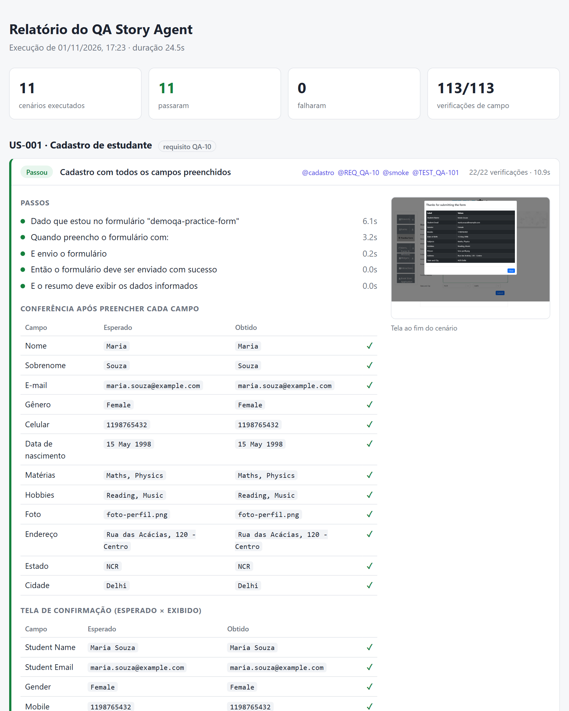
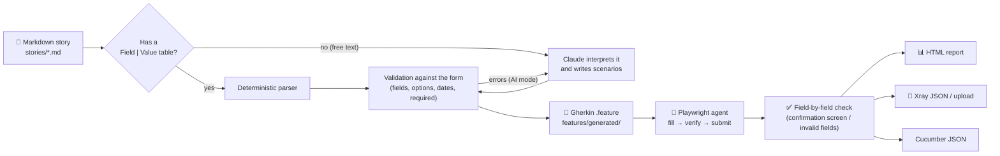
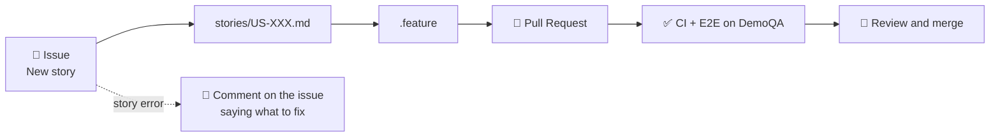

# QA Story Agent

[Português](README.md) · **English**

[](https://github.com/gaBuen0/qa-story-agent/actions/workflows/ci.yml)
[](https://github.com/gaBuen0/qa-story-agent/actions/workflows/e2e-demoqa.yml)


A QA agent that **reads a user story written in Markdown**, turns it into **BDD scenarios**, **fills in the form through the UI** the way a user would, and **checks the result field by field**. It produces a report with evidence and results ready for **Xray**.

> At work, I built a QA agent to automate a flow I used to do by hand: read a requirement, fill in a form, and check field by field that everything was saved correctly. That project is confidential, so I rebuilt the same idea in the open, with 100% fictional data, running against a public practice site ([DemoQA](https://demoqa.com/automation-practice-form)).

**📊 [See the report from the latest run](https://gabuen0.github.io/qa-story-agent/)**, published automatically on every E2E run on `main`.



> **About the language.** The project was written for a Brazilian team, so stories, Gherkin scenarios (`Dado / Quando / Então` = Given / When / Then) and the agent's messages are in Portuguese. The code identifiers are in English.

## How it works



1. **Story → scenarios.** Each file in `stories/` describes one feature. Scenarios written as a `Campo | Valor` (Field | Value) table are read by a deterministic parser. Stories written as prose, the way they usually arrive from the business, are interpreted by Claude.
2. **Validation before running.** Every scenario is checked against the form definition. Does the field exist? Is "Feminino" a valid option? Is "31/02" a date? Is a required field missing? All errors are reported at once, along with the accepted options.
3. **Versioned Gherkin.** The result becomes a `.feature` file with Xray tags (`@TEST_QA-101`, `@REQ_QA-10`). The file carries a hash of its story, so CI fails if someone changes a story and forgets to regenerate it.
4. **Running through the UI.** The agent opens the page and fills in each field the way a user would: clicking labels, picking a date in the calendar, typing into the autocomplete. It **reads back what ended up on screen** before moving on.
5. **Field-by-field check.** After submitting, it compares every row of the confirmation screen with what was entered, without stopping at the first mismatch. In negative scenarios, it checks which fields the screen marked as invalid. If a submission fails when it should have gone through, the agent investigates and reports which fields were rejected.

> **Why through the UI?** The original project had no access to the system's API, so every check had to go through the screen itself. I kept that constraint here on purpose: it is the most common situation in QA of enterprise systems.

## Story format

```markdown
---
id: US-001
alvo: demoqa-practice-form   # target form
requisito: QA-10             # optional: becomes @REQ_QA-10 (Xray)
tags: [cadastro]
---

# US-001 · Cadastro de estudante

**Como** secretaria acadêmica
**Quero** cadastrar um novo estudante pelo formulário de matrícula
**Para** que ele já comece o semestre com os dados corretos

## Cenário: Cadastro com todos os campos preenchidos

**Tags:** @smoke
**Xray:** QA-101              # optional: links to an existing Xray test

| Campo              | Valor              |
| ------------------ | ------------------ |
| Nome               | Maria              |
| Gênero             | Feminino           |
| Data de nascimento | 15/05/1998         |
| Matérias           | Matemática, Física |

**Resultado esperado:** enviado

## Cenário: Celular com menos de 10 dígitos

| Campo   | Valor     |
| ------- | --------- |
| Celular | 119876543 |

**Resultado esperado:** bloqueado
**Campos inválidos:** Celular
```

The narrative follows the usual "As a / I want / So that" (`Como / Quero / Para`). The expected result is either `enviado` (submitted) or `bloqueado` (blocked), and a blocked scenario lists the fields the form must reject (`Campos inválidos`).

Values can be written in Portuguese ("Feminino", "Matemática", "Leitura"). The agent converts them to what the screen expects (`Female`, `Maths`, `Reading`). Full examples are in [`stories/`](stories).

### Free-text stories (AI)

When a story has no table, like [`US-003`](stories/US-003-aluna-transferida.md), the agent sends the text and the form definition to **Claude**, which returns scenarios in a structured format (schema-validated JSON). That output goes through **the same validation** as hand-written scenarios. If anything is wrong, the errors go back to the model to fix (up to 3 attempts).

The `.feature` generated by the AI is **committed to the repository** so a person can review it, like any other code. As long as the story does not change, the reviewed file is reused and the model is not called again, not even in CI. See the result for US-003 in [`features/generated/US-003.feature`](features/generated/US-003.feature): one scenario per acceptance criterion, each quoting the passage it covers.

```bash
export ANTHROPIC_API_KEY=sk-ant-...     # PowerShell: $env:ANTHROPIC_API_KEY="sk-ant-..."
npm run stories:compile
```

Without a key, free-text stories are skipped with a warning and everything else works as usual.

### From card to test: a story opened as an issue

A story can also start as an **issue**, the way a card reaches QA. The [**Nova história**](.github/ISSUE_TEMPLATE/historia.yml) (New story) form asks for the ID, target form, requirement, narrative and scenarios. On save, the [`historia-da-issue.yml`](.github/workflows/historia-da-issue.yml) workflow does the rest:



- If the story has a problem (duplicate ID, a field that does not exist, a scenario with no expected result), the workflow comments on the issue saying what to fix. Editing the issue runs everything again and updates the same PR.
- The PR has the generated scenarios in its description and runs CI and the DemoQA scenarios before merge. Merging closes the issue.

Live example: issue [#1](https://github.com/gaBuen0/qa-story-agent/issues/1) became Pull Request [#2](https://github.com/gaBuen0/qa-story-agent/pull/2), with green checks.

Since the repository is public and anyone can open an issue, the flow has three safeguards:

- it only runs for issues from people with access to the repository (owner or collaborator);
- the issue text reaches the script only through environment variables, never interpolated into the command, to prevent command injection;
- anything that goes into the story header or the file name is validated by format ([tests](tests/unit/issue-form.test.ts) cover attempts such as `../../` and line breaks in the ID).

## Running locally

Requirements: Node.js 22+.

```bash
npm install
npx playwright install chromium

npm run stories:compile   # stories/*.md → features/generated/*.feature
npm run test:e2e          # runs the scenarios in the browser
npm run xray:export       # writes reports/xray-execution.json
```

Or all at once: `npm run qa`.

| Command | What it does |
| --- | --- |
| `npm run stories:compile` | Generates/updates the `.feature` files (use `-- --no-llm` to skip the AI) |
| `npm run stories:check` | Writes nothing; fails if any `.feature` is out of date (used in CI) |
| `npm run test:e2e` | Generates the playwright-bdd tests and runs them in Chromium |
| `npm run test:unit` | Unit tests for the parser, normalization, AI (mocked client) and Xray (mocked API) |
| `npm run test:agent` | Agent self-tests against a local form with planted defects (no internet) |
| `npm run typecheck` | Type checking |
| `npm run lint` / `npm run format` | Lint and formatting with [Biome](https://biomejs.dev) (`format` fixes what it can) |
| `npm run xray:export` | Converts the results to Xray's import format (`-- --upload` sends them) |
| `npm run story:from-issue` | Turns the event's issue into a story (used by the workflow; reads `ISSUE_*` from the environment) |

## Reports

After `npm run test:e2e`, the `reports/` folder contains:

| File | Purpose |
| --- | --- |
| `qa-report.html` | The agent's report: steps, an **expected × actual** table for each field and a screenshot of the final screen. A single file that opens offline. |
| `results.json` | Normalized results (feeds the HTML report and Xray) |
| `xray-execution.json` | Execution in Xray JSON format, with screenshots as evidence |
| `cucumber.json` | Standard Cucumber format, accepted by Xray, Allure and others |
| `playwright/` | Playwright's native report, with traces of failed scenarios |

## Xray integration

`npm run xray:export` builds the Xray Cloud execution import payload (`POST /api/v2/import/execution`):

- a scenario with `**Xray:** QA-101` updates test **QA-101**;
- a scenario without a key becomes a *Generic* test identified by story + scenario, linked to the story's requirement (`requisito: QA-10`);
- each result carries a comment with the mismatches found and the screenshot as evidence.

To actually upload, set the variables below and run `npm run xray:export -- --upload` (or let CI do it):

| Variable | Use |
| --- | --- |
| `XRAY_CLIENT_ID`, `XRAY_CLIENT_SECRET` | Xray Cloud API credentials |
| `XRAY_PROJECT_KEY` | Project where new tests are created (default `QA`) |
| `XRAY_TEST_PLAN_KEY` | (optional) Test plan for the execution |

The upload is tested against a [local server that mimics the Xray Cloud API](tests/unit/xray-upload.test.ts): authentication, token, import, credential and payload errors, and the `xray:export -- --upload` command end to end. It has not yet been exercised against a real Jira instance.

## Who tests the tester?

A QA agent that never fails proves nothing. So it has its own tests in [`tests/agent/`](tests/agent/agent-self-test.spec.ts), which run against a [local form](tests/agent/lab/formulario-lab.html) with **planted defects**, switched on through the URL. For each defect, the test requires the agent to flag the problem with the right message:

| Planted defect | The agent must say |
| --- | --- |
| Summary shows a different last name | `Nome completo: esperado "Beatriz Ramos", obtido "Beatriz Silva"` (expected vs. actual) |
| Summary drops an item from a list | `Hobbies: esperado "Esportes, Leitura", obtido "Esportes"` |
| Summary is missing a row | `Endereço: ... obtido "(linha ausente)"` (row missing) |
| Two defects at once | `2 de 6 verificações falharam` (2 of 6 checks failed): all of them, not just the first |
| Field cuts off the last digit | an error while filling, before submitting |
| Valid form that does not submit | `nenhum campo foi marcado como inválido` (no field was marked invalid) |
| Screen that accepts invalid data | `a história esperava que fosse bloqueado` (the story expected it to be blocked) |
| Story with a wrong expectation | `Nome: esperado "inválido", obtido "válido"` |

The form also runs **without defects**, to make sure the agent does not report bugs where there are none. And it runs in both confirmation formats, a summary and a new row in a table that already holds another record, to prove the agent checks the right row. These tests do not need internet access.

They have already paid off: they found a **false positive in the agent itself**. The submission confirmation was checked by its text but not by its visibility. On DemoQA this went unnoticed, because the confirmation is only added to the page after submitting. On a form that keeps a hidden confirmation in the page, the agent would have said "submitted successfully" without any submission at all.

## CI (GitHub Actions)

There are two workflows, split on purpose. DemoQA is a public site that is sometimes unstable, and an outage there should not turn the repository red.

**[`ci.yml`](.github/workflows/ci.yml)** runs on every push and PR, with no internet dependency:

1. lint and formatting (Biome), type checking and unit tests;
2. `stories:check`, which ensures the `.feature` files are in sync with the stories;
3. the agent's self-tests against the local form with planted defects.

**[`e2e-demoqa.yml`](.github/workflows/e2e-demoqa.yml)** runs every Monday, on demand, and when stories, features or the agent's code change:

1. runs the scenarios on DemoQA (Chromium);
2. exports to Xray (and uploads, if the `XRAY_CLIENT_ID`/`XRAY_CLIENT_SECRET` secrets exist);
3. publishes the reports as a run artifact;
4. on `main`, publishes the agent's report to [GitHub Pages](https://gabuen0.github.io/qa-story-agent/).

So a red E2E badge with a green CI points straight at the external site, not at the code.

### Using it in a fork

CI and E2E work with no setup. The extras need to be turned on in the repository:

| To | Do |
| --- | --- |
| Publish the report to GitHub Pages | *Settings → Pages → Source: GitHub Actions* and the repository variable `PUBLISH_REPORT=true` |
| Open stories as issues | Create the `historia` label and check *Settings → Actions → General → Allow GitHub Actions to create and approve pull requests* |
| Free-text stories in the issue flow | The `ANTHROPIC_API_KEY` secret (stories with a table do not need it) |
| Upload to Xray Cloud | The `XRAY_CLIENT_ID` and `XRAY_CLIENT_SECRET` secrets |

## Structure

```
stories/                  User stories (the agent's input)
features/generated/       Generated Gherkin (committed, reviewable)
fixtures/files/           Files used in uploads
src/
  story/                  Markdown parser, AI interpreter, validation, Gherkin generator
  targets/                Declarative definition of each form + value normalization
  agent/                  The agent: handlers per field and confirmation type, filling and checking
  steps/                  Generic BDD steps (work for any form)
  reporting/              Playwright reporter, HTML report and Xray export
  cli/                    compile-stories, xray-export and issue-to-story commands
tests/unit/               Unit tests
tests/agent/              Agent self-tests (local form with planted defects)
```

## Two forms, the same steps

Everything the agent knows about a screen lives in a single declarative file. Today there are two very different forms, tested with the same BDD steps and the same agent:

| | [Student registration](src/targets/demoqa-practice-form.ts) | [Employee registration](src/targets/demoqa-web-tables.ts) |
| --- | --- | --- |
| Stories | [US-001](stories/US-001-cadastro-de-estudante.md), [US-002](stories/US-002-validacoes-do-cadastro.md), [US-003](stories/US-003-aluna-transferida.md) | [US-004](stories/US-004-cadastro-de-funcionario.md) |
| Components | text, radio, checkbox, date picker, autocomplete, select, upload | text fields only, inside a dialog |
| Confirmation | dialog with a label → value summary | **a new row in a table** that already holds other records |

Each field is one line of configuration:

```ts
{ key: 'gender', label: 'Gênero', kind: 'radio-group', selector: '#genterWrapper',
  options: [{ value: 'Female', aliases: ['Feminino', 'F'] }, ...] }
```

And so is the confirmation:

```ts
confirmation: { kind: 'table-row', tableSelector: 'table', keyColumn: 'Email' }
```

In table mode, the agent finds the new row by the key column and checks the other columns. That way it points out which column was saved wrong, instead of just saying "the row did not show up".

To test another form: create a file in `src/targets/`, register it in `registry.ts` and use its `id` in the story's `alvo:` field. The BDD steps do not change. A new component needs a handler (`fill` + `read`) in [`src/agent/field-handlers.ts`](src/agent/field-handlers.ts). A new confirmation format needs a handler (`locate` + `read`) in [`src/agent/confirmations.ts`](src/agent/confirmations.ts).

## Technical decisions

- **The screen described as data.** The form's fields, options and rules are configuration, not code scattered across tests. Steps and agent are generic.
- **The agent checks its own work.** After filling each field, it reads the value back from the screen. A date picker that did not take the date shows up as a filling error, not as a mysterious failure at the end.
- **Assertions that collect everything.** The check gathers every mismatch before failing. A report saying "3 of 10 fields wrong" is worth more than stopping at the first one.
- **AI with a safety net.** The model can only choose among fields and options that exist (schema with `enum`), its output goes through the same deterministic validation, errors go back for correction, and a person reviews the result before it becomes a test.
- **Versioned interpretation.** The AI-generated `.feature` lives in Git. Runs are reproducible, CI does not need an API key, and changes in interpretation show up in a diff.
- **Gherkin in Portuguese.** Whoever writes the story can read the scenario without translating it.
- **Biome instead of ESLint + Prettier.** `typescript-eslint` does not support TypeScript 7 yet. Biome does lint and formatting in one tool, without depending on the compiler. The rule against the `!` operator is off: with `noUncheckedIndexedAccess` on, `!` is the explicit way to assert that a value exists.

## Next steps

- [ ] Exploratory mode: the agent discovers the screen's fields and suggests the form definition
- [ ] Parallel runs across multiple browsers (Firefox/WebKit)

---

Made by **Gabriel Bueno**. Data and stories are fictional; DemoQA is a public site maintained by ToolsQA for automation practice.
