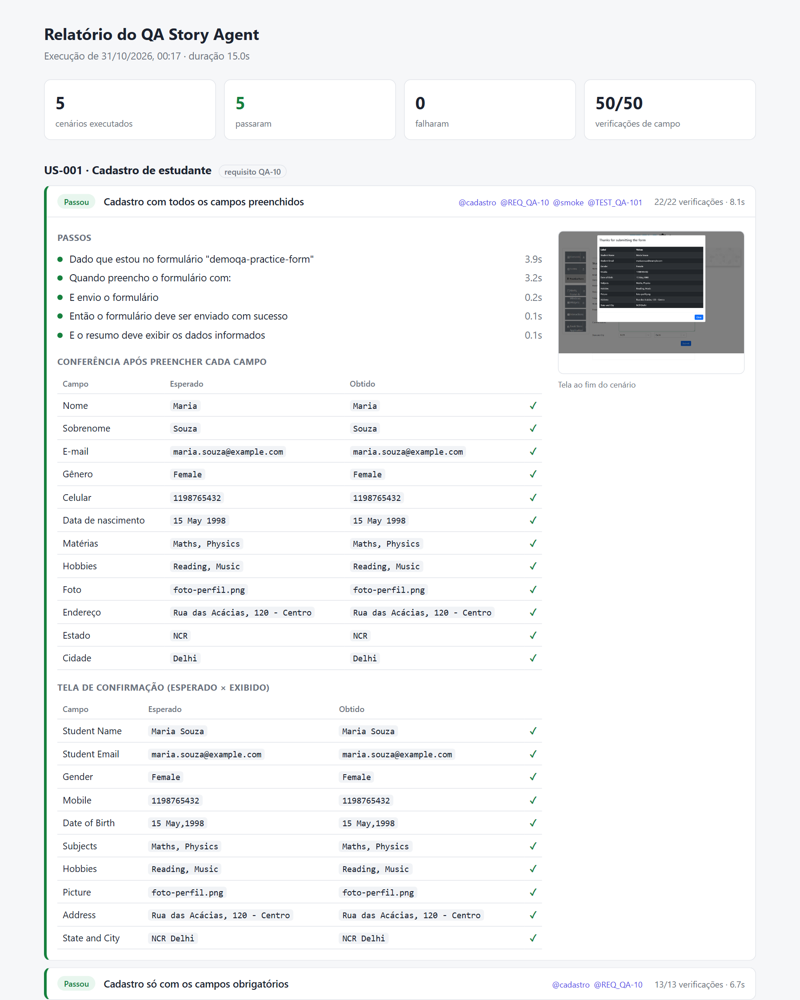
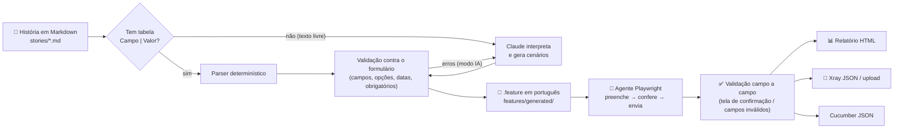

# QA Story Agent

[](https://github.com/gaBuen0/qa-story-agent/actions/workflows/ci.yml)
[](https://github.com/gaBuen0/qa-story-agent/actions/workflows/e2e-demoqa.yml)


Um agente de QA que **lê uma história de usuário em Markdown**, transforma em **cenários BDD**, **preenche o formulário pela interface** como um usuário faria e **valida o resultado campo a campo** — gerando relatório com evidências e resultados prontos para o **Xray**.

> No trabalho, construí um agente de QA para automatizar um fluxo que eu fazia à mão: ler um requisito, preencher um formulário e conferir campo por campo se tudo foi gravado certo. Esse projeto é confidencial, então recriei a mesma ideia de forma aberta, com dados 100% fictícios e rodando num site público de prática ([DemoQA](https://demoqa.com/automation-practice-form)).

**📊 [Ver o relatório da última execução](https://gabuen0.github.io/qa-story-agent/)**, publicado automaticamente a cada execução do E2E na `main`.



## Como funciona



1. **História → cenários.** Cada arquivo em `stories/` descreve uma funcionalidade. Cenários escritos como tabela `Campo | Valor` são lidos por um parser determinístico. Histórias em texto corrido (como costumam chegar do negócio) são interpretadas pelo Claude.
2. **Validação antes de executar.** Todo cenário é checado contra a definição do formulário: o campo existe? "Feminino" é uma opção válida? "31/02" é data? Faltou campo obrigatório? Os erros aparecem todos de uma vez, com as opções aceitas.
3. **Gherkin versionado.** O resultado vira um `.feature` em português (`Dado / Quando / Então`), com tags do Xray (`@TEST_QA-101`, `@REQ_QA-10`). O arquivo leva o hash da história: o CI falha se alguém mudar a história e esquecer de regenerar.
4. **Execução pela interface.** O agente abre a página, preenche cada campo do jeito que um usuário faria (clicando em rótulos, escolhendo no calendário, digitando no autocomplete) e **lê de volta o que ficou na tela** antes de seguir.
5. **Validação campo a campo.** Depois do envio, compara cada linha da tela de confirmação com o que foi preenchido, sem parar na primeira divergência. Em cenários negativos, confere quais campos a tela marcou como inválidos. Se o envio falhar quando deveria passar, o agente investiga e diz quais campos foram recusados.

> **Por que pela interface?** No projeto original não havia acesso à API do sistema, então toda validação precisava ser feita pela própria tela. Mantive essa restrição aqui de propósito: é o cenário mais comum em QA de sistemas corporativos.

## Formato da história

```markdown
---
id: US-001
alvo: demoqa-practice-form
requisito: QA-10        # opcional: vira @REQ_QA-10 (Xray)
tags: [cadastro]
---

# US-001 · Cadastro de estudante

**Como** secretaria acadêmica
**Quero** cadastrar um novo estudante pelo formulário de matrícula
**Para** que ele já comece o semestre com os dados corretos

## Cenário: Cadastro com todos os campos preenchidos

**Tags:** @smoke
**Xray:** QA-101         # opcional: vincula a um teste existente no Xray

| Campo              | Valor              |
| ------------------ | ------------------ |
| Nome               | Maria              |
| Gênero             | Feminino           |
| Data de nascimento | 15/05/1998         |
| Matérias           | Matemática, Física |

**Resultado esperado:** enviado

## Cenário: Celular com menos de 10 dígitos

| Campo   | Valor     |
| ------- | --------- |
| Celular | 119876543 |

**Resultado esperado:** bloqueado
**Campos inválidos:** Celular
```

Os valores podem ser escritos em português ("Feminino", "Matemática", "Leitura"). O agente converte para o que a tela espera (`Female`, `Maths`, `Reading`). Exemplos completos em [`stories/`](stories).

### Histórias em texto livre (IA)

Se a história não tem tabela, como [`US-003`](stories/US-003-aluna-transferida.md), o agente envia o texto e a definição do formulário ao **Claude**, que devolve cenários em formato estruturado (JSON validado por schema). A saída passa pela **mesma validação** dos cenários escritos à mão; se houver problema, os erros voltam para o modelo corrigir (até 3 tentativas).

O `.feature` gerado pela IA é **versionado no repositório** para ser revisado por uma pessoa, como qualquer código. Enquanto a história não mudar, o arquivo revisado é reaproveitado e o modelo não é chamado de novo (nem no CI). Veja o resultado da US-003 em [`features/generated/US-003.feature`](features/generated/US-003.feature): um cenário para cada critério da história, cada um citando o trecho que cobre.

```bash
export ANTHROPIC_API_KEY=sk-ant-...     # PowerShell: $env:ANTHROPIC_API_KEY="sk-ant-..."
npm run stories:compile
```

Sem chave configurada, as histórias em texto livre são puladas com um aviso e o restante funciona normalmente.

## Rodando localmente

Requisitos: Node.js 22+.

```bash
npm install
npx playwright install chromium

npm run stories:compile   # stories/*.md → features/generated/*.feature
npm run test:e2e          # executa os cenários no navegador
npm run xray:export       # gera reports/xray-execution.json
```

Ou tudo de uma vez: `npm run qa`.

| Comando | O que faz |
| --- | --- |
| `npm run stories:compile` | Gera/atualiza os `.feature` (use `-- --no-llm` para não chamar a IA) |
| `npm run stories:check` | Não grava nada; falha se algum `.feature` estiver desatualizado (usado no CI) |
| `npm run test:e2e` | Gera os testes do playwright-bdd e executa no Chromium |
| `npm run test:unit` | Testes unitários do parser, normalização, IA (com cliente simulado) e Xray |
| `npm run test:agent` | Autotestes do agente contra um formulário local com defeitos plantados (sem internet) |
| `npm run typecheck` | Checagem de tipos |
| `npm run lint` / `npm run format` | Lint e formatação com [Biome](https://biomejs.dev) (o `format` corrige o que der) |
| `npm run xray:export` | Converte os resultados para o formato de importação do Xray (`-- --upload` envia) |

## Relatórios

Depois de `npm run test:e2e`, a pasta `reports/` contém:

| Arquivo | Para quê |
| --- | --- |
| `qa-report.html` | Relatório do agente: passos, tabela **esperado × obtido** de cada campo e print da tela final. Arquivo único, abre offline. |
| `results.json` | Resultados normalizados (alimenta o HTML e o Xray) |
| `xray-execution.json` | Execução no formato Xray JSON, com prints como evidência |
| `cucumber.json` | Formato Cucumber padrão, aceito por Xray, Allure e outros |
| `playwright/` | Relatório nativo do Playwright, com trace dos cenários que falharam |

## Integração com o Xray

O `npm run xray:export` gera o payload de importação de execução do Xray Cloud (`POST /api/v2/import/execution`):

- cenário com `**Xray:** QA-101` atualiza o teste **QA-101**;
- cenário sem chave vira um teste *Generic* identificado por história + cenário, vinculado ao requisito da história (`requisito: QA-10`);
- cada resultado leva comentário com as divergências encontradas e o print como evidência.

Para enviar de verdade, configure as variáveis abaixo e rode `npm run xray:export -- --upload` (ou deixe o CI fazer isso):

| Variável | Uso |
| --- | --- |
| `XRAY_CLIENT_ID`, `XRAY_CLIENT_SECRET` | Credenciais da API do Xray Cloud |
| `XRAY_PROJECT_KEY` | Projeto onde os testes novos são criados (padrão `QA`) |
| `XRAY_TEST_PLAN_KEY` | (opcional) Plano de teste da execução |

## Quem testa o testador?

Um agente de QA que nunca falha não prova nada. Por isso ele tem os próprios testes em [`tests/agent/`](tests/agent/agent-self-test.spec.ts), que rodam contra um [formulário local](tests/agent/lab/formulario-lab.html) com **defeitos plantados**, ligados pela URL. Para cada defeito, o teste exige que o agente acuse o problema com a mensagem certa:

| Defeito plantado | O agente precisa dizer |
| --- | --- |
| Resumo mostra outro sobrenome | `Nome completo: esperado "Beatriz Ramos", obtido "Beatriz Silva"` |
| Resumo perde um item de uma lista | `Hobbies: esperado "Esportes, Leitura", obtido "Esportes"` |
| Resumo sem uma linha | `Endereço: ... obtido "(linha ausente)"` |
| Dois defeitos ao mesmo tempo | `2 de 6 verificações falharam`: todos de uma vez, não só o primeiro |
| Campo corta o último dígito | erro já no preenchimento, antes do envio |
| Formulário válido que não envia | `nenhum campo foi marcado como inválido` |
| Tela que aceita dado inválido | `a história esperava que fosse bloqueado` |
| História com expectativa errada | `Nome: esperado "inválido", obtido "válido"` |

O formulário também roda **sem defeito**, para garantir que o agente não acusa bug onde não há. E roda nos dois formatos de confirmação: resumo e linha nova numa tabela que já tem outro registro, para provar que o agente confere a linha certa. Esses testes não dependem de internet.

Eles já se pagaram: encontraram um **falso positivo no próprio agente**. A confirmação de envio era conferida pelo texto, mas não pela visibilidade. No DemoQA isso passava despercebido, porque a confirmação só é criada na página depois do envio. Num formulário que já deixa a confirmação escondida na página, o agente diria "enviado com sucesso" sem envio nenhum.

## CI (GitHub Actions)

São dois workflows, separados de propósito. O DemoQA é um site público que às vezes fica instável, e uma queda dele não deveria deixar o repositório vermelho.

**[`ci.yml`](.github/workflows/ci.yml)** roda em todo push e PR, sem depender de internet:

1. lint e formatação (Biome), checagem de tipos e testes unitários;
2. `stories:check`, que garante que os `.feature` estão em sincronia com as histórias;
3. autotestes do agente contra o formulário local com defeitos plantados.

**[`e2e-demoqa.yml`](.github/workflows/e2e-demoqa.yml)** roda toda segunda-feira, sob demanda e quando mudam as histórias, as features ou o código do agente:

1. execução dos cenários no DemoQA (Chromium);
2. exportação para o Xray (e upload, se os secrets `XRAY_CLIENT_ID`/`XRAY_CLIENT_SECRET` existirem);
3. relatórios publicados como artefato da execução;
4. na `main`, o relatório do agente é publicado no [GitHub Pages](https://gabuen0.github.io/qa-story-agent/).

Assim, um badge vermelho no E2E com o CI verde aponta direto para o site externo, e não para o código.

Para ligar o Pages num fork, ative *Settings → Pages → Source: GitHub Actions* e crie a variável de repositório `PUBLISH_REPORT=true`.

## Estrutura

```
stories/                  Histórias de usuário (entrada do agente)
features/generated/       Gherkin gerado (versionado, revisável)
fixtures/files/           Arquivos usados em uploads
src/
  story/                  Parser de Markdown, intérprete com IA, validação, gerador de Gherkin
  targets/                Definição declarativa de cada formulário + normalização de valores
  agent/                  O agente: handlers por tipo de campo e de confirmação, preenchimento e validação
  steps/                  Passos BDD genéricos (valem para qualquer formulário)
  reporting/              Reporter do Playwright, relatório HTML e exportação Xray
  cli/                    Comandos compile-stories e xray-export
tests/unit/               Testes unitários
tests/agent/              Autotestes do agente (formulário local com defeitos plantados)
```

## Dois formulários, os mesmos passos

Tudo o que o agente sabe sobre uma tela fica num único arquivo declarativo. Hoje são dois formulários bem diferentes, testados com os mesmos passos BDD e o mesmo agente:

| | [Cadastro de estudante](src/targets/demoqa-practice-form.ts) | [Cadastro de funcionário](src/targets/demoqa-web-tables.ts) |
| --- | --- | --- |
| História | [US-001](stories/US-001-cadastro-de-estudante.md), [US-002](stories/US-002-validacoes-do-cadastro.md), [US-003](stories/US-003-aluna-transferida.md) | [US-004](stories/US-004-cadastro-de-funcionario.md) |
| Componentes | texto, radio, checkbox, calendário, autocomplete, select, upload | só campos de texto, dentro de uma janela |
| Confirmação | janela com resumo rótulo → valor | **linha nova numa tabela** que já tem outros registros |

Cada campo é uma linha de configuração:

```ts
{ key: 'gender', label: 'Gênero', kind: 'radio-group', selector: '#genterWrapper',
  options: [{ value: 'Female', aliases: ['Feminino', 'F'] }, ...] }
```

E a confirmação também:

```ts
confirmation: { kind: 'table-row', tableSelector: 'table', keyColumn: 'Email' }
```

No modo tabela, o agente acha a linha nova pela coluna-chave e confere as demais colunas. Assim ele aponta qual coluna foi gravada errada, em vez de só dizer que "a linha não apareceu".

Para testar outro formulário: crie um arquivo em `src/targets/`, registre em `registry.ts` e use o `id` dele no campo `alvo:` da história. Os passos BDD não mudam. Um componente novo pede um handler (`fill` + `read`) em [`src/agent/field-handlers.ts`](src/agent/field-handlers.ts). Um formato novo de confirmação pede um handler (`locate` + `read`) em [`src/agent/confirmations.ts`](src/agent/confirmations.ts).

## Decisões técnicas

- **Tela descrita como dados.** Campos, opções e regras do formulário são configuração, não código espalhado pelos testes. Passos e agente são genéricos.
- **O agente confere o próprio trabalho.** Depois de preencher cada campo, ele lê o valor de volta da tela. Um calendário que não aceitou a data aparece como erro de preenchimento, não como falha misteriosa no fim.
- **Asserções que coletam tudo.** A validação junta todas as divergências antes de falhar. Um relatório com "3 de 10 campos errados" vale mais do que parar no primeiro.
- **IA com rede de proteção.** O modelo só escolhe entre campos e opções que existem (schema com `enum`), a saída passa pela mesma validação determinística, os erros voltam para correção e o resultado é revisado por uma pessoa antes de virar teste.
- **Interpretação versionada.** O `.feature` gerado pela IA fica no Git. Execuções são reprodutíveis, o CI não depende de chave de API e mudanças na interpretação aparecem num diff.
- **Gherkin em português.** Quem escreve a história lê o cenário sem traduzir.
- **Biome no lugar de ESLint + Prettier.** O `typescript-eslint` ainda não suporta o TypeScript 7. O Biome faz lint e formatação numa ferramenta só, sem depender do compilador. A regra contra o operador `!` fica desligada: com `noUncheckedIndexedAccess` ligado, o `!` é a forma explícita de afirmar que o valor existe.

## Próximos passos

- [ ] Modo exploratório: o agente descobre os campos da tela e sugere a definição do formulário
- [ ] Execução em paralelo em múltiplos navegadores (Firefox/WebKit)

---

Feito por **Gabriel Bueno**. Dados e histórias são fictícios; o DemoQA é um site público mantido pela ToolsQA para prática de automação.
